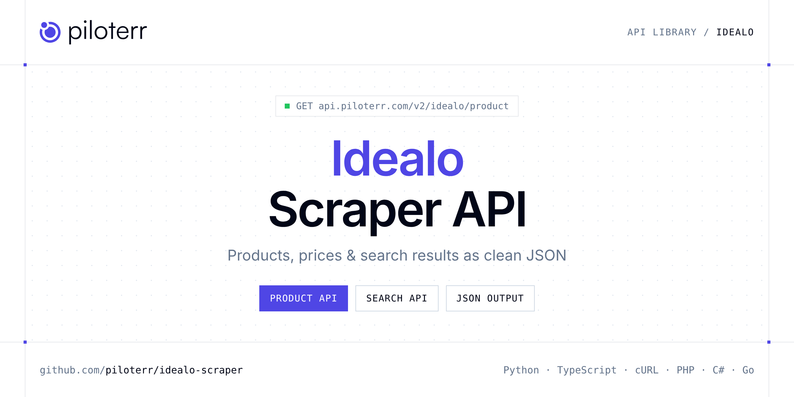

<p align="center">
  <a href="https://www.piloterr.com"></a>
</p>

# Idealo Scraper API

[](https://discord.gg/CFj3ph8aHU) [](https://app.piloterr.com) [](https://app.piloterr.com/openapi) [](LICENSE)

The **Piloterr Idealo Scraper API** lets you extract public data from Idealo as **clean, structured JSON** — no proxies, headless browsers or HTML parsing to maintain. Endpoints available in production:

- **Idealo Product API** — Get an Idealo product from Spain, France, or Germany.
- **Idealo Search API** — Search Idealo Spain, France, and Germany.

Use it for price monitoring, assortment tracking, competitor analysis, product research or catalog enrichment.

| Endpoint | Path | Credits | What you get |
|---|---|---|---|
| [Idealo Product API](#idealo-product-api) | `/v2/idealo/product` | 3 | Get an Idealo product from Spain, France, or Germany. URL or product id. Offers, shipping, specs, and images via WebUnlocker (3 credits). |
| [Idealo Search API](#idealo-search-api) | `/v2/idealo/search` | 3 | Search Idealo Spain, France, and Germany. Keyword or search URL. Prices, shipping, ratings, and pagination via WebUnlocker (3 credits). |

## Table of contents

- [How it works](#how-it-works)
- [Idealo Product API](#idealo-product-api)
- [Idealo Search API](#idealo-search-api)
- [Code examples in other languages](#code-examples-in-other-languages)
- [Practical use cases](#practical-use-cases)
- [Why Piloterr?](#why-piloterr)
- [FAQ](#faq)
- [Official SDKs](#official-sdks)
- [Related scrapers](#related-scrapers)
- [Support](#support)

## How it works

1. **Create a free Piloterr account** and copy your API key from the [dashboard](https://app.piloterr.com).
2. **Send a `GET` (or `POST`) request** to `https://api.piloterr.com/v2/...` with the header `x-api-key: YOUR_API_KEY`.
3. **Receive structured JSON** — Piloterr handles rendering, proxies, retries and parsing.

```bash
export PILOTERR_API_KEY="your-api-key"
pip install requests        # Python
# TypeScript: Node.js 18+ (native fetch), run with `npx tsx file.ts`
```

> Every endpoint accepts both `GET` (query string) and `POST` (JSON body with the same fields).

## Idealo Product API

Get an Idealo product from Spain, France, or Germany. URL or product id. Offers, shipping, specs, and images via WebUnlocker (3 credits).

`GET | POST https://api.piloterr.com/v2/idealo/product` · **3 credits per request** · [Full reference](https://app.piloterr.com/openapi)

### Request parameters

| Parameter | Type | Required | Description |
|---|---|---|---|
| `query` | string | ✅ | Full Idealo product URL, or a numeric product id. |
| `country` | string | — | Region when `query` is a numeric product id. |

### Python example

```python
import json
import os
import requests

response = requests.get(
    "https://api.piloterr.com/v2/idealo/product",
    headers={"x-api-key": os.environ["PILOTERR_API_KEY"]},
    params={
        "query": "https://www.idealo.es/precios/205227870/asics-novablast-5-1011b974.html",
    },
    timeout=120,
)
response.raise_for_status()
data = response.json()

print(json.dumps(data, indent=2, ensure_ascii=False)[:2000])
```

### TypeScript example

```typescript
type IdealoProduct = {
  id?: string;
  sku?: string;
  url?: string;
  brand?: string;
  price?: {
    max?: number;
    min?: number;
    currency?: string;
    offer_count?: number;
  };
  specs?: {
    Drop?: string;
    Para?: string;
    Serie?: string;
    Cierre?: string;
    "Para uso"?: string;
    Atención?: string;
    Superficie?: string;
    Entresuelas?: string;
    Propiedades?: string;
    Equipamiento?: string;
    "Material exterior"?: string;
    "Material interior"?: string;
    "Tipos de producto"?: string;
    "T\u00e9cnica de carrera"?: string;
    "Materiales de la suela"?: string;
    "Sistemas de amortiguaci\u00f3n"?: string;
    "Caracter\u00edsticas de la suela"?: string;
    "Caracter\u00edsticas de la plantilla"?: string;
  };
  title?: string;
  images?: string[];
  offers?: {
    url?: string;
    shop?: string;
    price?: number;
    shop_id?: string;
    currency?: string;
    shipping?: number;
  }[];
  rating?: number;
  country?: string;
  description?: string;
  review_count?: number;
};

const params = new URLSearchParams({
  "query": "https://www.idealo.es/precios/205227870/asics-novablast-5-1011b974.html",
});

const response = await fetch(`https://api.piloterr.com/v2/idealo/product?${params}`, {
  headers: { "x-api-key": process.env.PILOTERR_API_KEY! },
});
if (!response.ok) throw new Error(`Piloterr error ${response.status}: ${await response.text()}`);

const data = (await response.json()) as IdealoProduct;

console.log(JSON.stringify(data, null, 2).slice(0, 2000));
```

<details>
<summary><b>POST variant</b></summary>

```http
POST https://api.piloterr.com/v2/idealo/product
x-api-key: YOUR_API_KEY
Content-Type: application/json

{"query": "https://www.idealo.es/precios/205227870/asics-novablast-5-1011b974.html"}
```
</details>

### Output example

Example response from the API reference, abridged — real values depend on the page you scrape.

```json
{
  "id": "205227870",
  "sku": "205227870",
  "url": "https://www.idealo.es/precios/205227870/asics-novablast-5-1011b974.html",
  "brand": "Asics",
  "price": {
    "max": 225.01,
    "min": 105,
    "currency": "EUR",
    "offer_count": 163
  },
  "specs": {
    "Drop": "8 mm",
    "Para": "hombre",
    "Serie": "Asics Novablast",
    "Cierre": "cordones",
    "Para uso": "entrenamiento, carrera",
    "Atención": "Las ofertas pueden incluir productos de diferentes tallas",
    "Superficie": "todoterreno",
    "Entresuelas": "BOUNCE, espuma",
    "Propiedades": "amortiguación, ligeras, transpirable",
    "Equipamiento": "reflectantes, talón reforzado",
    "Material exterior": "textil",
    "Material interior": "malla",
    "Tipos de producto": "Zapatillas con amortiguación, Zapatillas running ligeras",
    "Técnica de carrera": "apoyo con el retropié",
    "Materiales de la suela": "espuma, AHAR",
    "Sistemas de amortiguación": "FF Blast Plus, FF Blast, FF BLAST PLUS ECO",
    "Características de la suela": "amortiguación",
    "Características de la plantilla": "transpirable"
  },
  "title": "Asics Novablast 5 (1011B974)",
  "images": [
    "https://cdn.idealo.com/folder/Product/205274/0/205274075/s11_produktbild_max/asics-novablast-5-1011b974-500-greyish-purple-coral-reef.jpg",
    "https://cdn.idealo.com/folder/Product/208662/4/208662404/s11_produktbild_max/asics-novablast-5-1011b974-black-cobalt-burst.jpg"
  ],
  "offers": [
    {
      "url": "https://www.idealo.es/relocator/relocate?categoryId=22875&offerKey=6a184d7d786523382f943b3456543900&pos=1&price=105.00&productid=20522787…",
      "shop": "amazon.es",
      "price": 105,
      "shop_id": "285299",
      "currency": "EUR",
      "shipping": 0
    },
    {
      "url": "https://www.idealo.es/relocator/relocate?categoryId=22875&offerKey=002a5a5f7de0d6b2a3911ce153a7ca0e&pos=2&price=105.00&productid=20522787…",
      "shop": "runnerinn.com (ES)",
      "price": 105,
      "shop_id": "307375",
      "currency": "EUR",
      "shipping": 1.99
    }
  ],
  "rating": 4.9,
  "country": "es",
  "description": "Zapatillas running Asics  Novablast 5 (1011B974) al mejor precio en idealo.es ! | ✓ Guía para comprar online ✓ Análisis y opiniones ✓ Las…",
  "review_count": 10
}
```

### Response fields

| Field | Type | Description |
|---|---|---|
| `id` | string |  |
| `sku` | string |  |
| `url` | string |  |
| `brand` | string |  |
| `price` | object |  |
| `price.max` | number |  |
| `price.min` | integer |  |
| `price.currency` | string |  |
| `price.offer_count` | integer |  |
| `specs` | object |  |
| `specs.Drop` | string |  |
| `specs.Para` | string |  |
| `specs.Serie` | string |  |
| `specs.Cierre` | string |  |
| `specs.Para uso` | string |  |
| `specs.Atención` | string |  |
| `specs.Superficie` | string |  |
| `specs.Entresuelas` | string |  |
| `specs.Propiedades` | string |  |
| `specs.Equipamiento` | string |  |
| `specs.Material exterior` | string |  |
| `specs.Material interior` | string |  |
| `specs.Tipos de producto` | string |  |
| `specs.Técnica de carrera` | string |  |
| `specs.Materiales de la suela` | string |  |

## Idealo Search API

Search Idealo Spain, France, and Germany. Keyword or search URL. Prices, shipping, ratings, and pagination via WebUnlocker (3 credits).

`GET | POST https://api.piloterr.com/v2/idealo/search` · **3 credits per request** · [Full reference](https://app.piloterr.com/openapi)

### Request parameters

| Parameter | Type | Required | Description |
|---|---|---|---|
| `query` | string | ✅ | Keyword or full Idealo search URL for Spain, France, or Germany. |
| `country` | string | — | Region when `query` is a keyword. |
| `page` | number | — | Search page. `2` appends `?page=2`. |

### Python example

```python
import json
import os
import requests

response = requests.get(
    "https://api.piloterr.com/v2/idealo/search",
    headers={"x-api-key": os.environ["PILOTERR_API_KEY"]},
    params={
        "query": "maison",
    },
    timeout=120,
)
response.raise_for_status()
data = response.json()

print(json.dumps(data, indent=2, ensure_ascii=False)[:2000])
```

### TypeScript example

```typescript
type IdealoSearch = {
  results?: {
    id?: string;
    url?: string;
    image?: string;
    price?: number;
    title?: string;
    rating?: number;
    currency?: string;
    shipping?: number;
    shop_name?: string;
    category_id?: string;
    offer_count?: number;
    review_count?: number;
    characteristics?: string[];
  }[];
  pagination?: {
    next?: string;
    page?: number;
    per_page?: number;
    total_pages?: number;
    total_results?: number;
  };
};

const params = new URLSearchParams({
  "query": "maison",
});

const response = await fetch(`https://api.piloterr.com/v2/idealo/search?${params}`, {
  headers: { "x-api-key": process.env.PILOTERR_API_KEY! },
});
if (!response.ok) throw new Error(`Piloterr error ${response.status}: ${await response.text()}`);

const data = (await response.json()) as IdealoSearch;

console.log(JSON.stringify(data, null, 2).slice(0, 2000));
```

<details>
<summary><b>POST variant</b></summary>

```http
POST https://api.piloterr.com/v2/idealo/search
x-api-key: YOUR_API_KEY
Content-Type: application/json

{"query": "maison"}
```
</details>

### Output example

Example response from the API reference, abridged — real values depend on the page you scrape.

```json
{
  "results": [
    {
      "id": "200139376",
      "url": "https://www.idealo.es/precios/200139376/maison-margiela-replica-jazz-club-eau-de-toilette.html",
      "image": "https://cdn.idealo.com/folder/Product/200139/3/200139376/s11_produktbild_mittelgross/maison-margiela-replica-jazz-club-eau-de-toilette.jpg",
      "price": 25.5,
      "title": "Maison Margiela Replica Jazz Club Eau de Toilette",
      "rating": 4.5,
      "currency": "EUR",
      "shipping": 3.95,
      "shop_name": "notino.es",
      "category_id": "16252",
      "offer_count": 26,
      "review_count": 158,
      "characteristics": [
        "Eau de Toilette unisex",
        "cuero"
      ]
    },
    {
      "id": "201140705",
      "url": "https://www.idealo.es/precios/201140705/maison-margiela-replica-by-the-fireplace-eau-de-toilette.html",
      "image": "https://cdn.idealo.com/folder/Product/201140/7/201140705/s11_produktbild_mittelgross/maison-margiela-replica-by-the-fireplace-eau-de-toil…",
      "price": 22.79,
      "title": "Maison Margiela Replica By the Fireplace Eau de Toilette",
      "rating": 4.5,
      "currency": "EUR",
      "shipping": 4.95,
      "shop_name": "deloox.es",
      "category_id": "16252",
      "offer_count": 20,
      "review_count": 11,
      "characteristics": [
        "Eau de Toilette unisex",
        "amaderado"
      ]
    }
  ],
  "pagination": {
    "next": "https://www.idealo.es/resultados.html?q=maison&page=2",
    "page": 1,
    "per_page": 60,
    "total_pages": 23,
    "total_results": 1370
  }
}
```

### Response fields

| Field | Type | Description |
|---|---|---|
| `results[]` | object[] |  |
| `results[].id` | string |  |
| `results[].url` | string |  |
| `results[].image` | string |  |
| `results[].price` | number |  |
| `results[].title` | string |  |
| `results[].rating` | number |  |
| `results[].currency` | string |  |
| `results[].shipping` | number |  |
| `results[].shop_name` | string |  |
| `results[].category_id` | string |  |
| `results[].offer_count` | integer |  |
| `results[].review_count` | integer |  |
| `results[].characteristics` | string[] |  |
| `pagination` | object |  |
| `pagination.next` | string |  |
| `pagination.page` | integer |  |
| `pagination.per_page` | integer |  |
| `pagination.total_pages` | integer |  |
| `pagination.total_results` | integer |  |

## Code examples in other languages

Ready-to-run examples live in the [`examples/`](examples) folder. Each one reads your key from the `PILOTERR_API_KEY` environment variable.

| Language | Product | Search |
|---|---|---|
| cURL (Bash) | [`product`](examples/curl/product.sh) | [`search`](examples/curl/search.sh) |
| PHP | [`product`](examples/php/product.php) | [`search`](examples/php/search.php) |
| C# | [`product`](examples/csharp/Product.cs) | [`search`](examples/csharp/Search.cs) |
| Go | [`product`](examples/go/product.go) | [`search`](examples/go/search.go) |
| Java | [`product`](examples/java/ProductExample.java) | [`search`](examples/java/SearchExample.java) |
| Ruby | [`product`](examples/ruby/product.rb) | [`search`](examples/ruby/search.rb) |
| Node.js | [`product`](examples/nodejs/product.mjs) | [`search`](examples/nodejs/search.mjs) |

## Practical use cases

- **Price monitoring** — Track prices, promotions and availability over time to react to competitors.
- **Assortment & catalog tracking** — Follow new products, delisted items and category changes.
- **Competitor analysis** — Benchmark ranges, brands and positioning across retailers.
- **Product research** — Spot best-sellers and trends from search results.
- **Catalog enrichment** — Pull titles, images and attributes into your PIM or marketplace listings.

## Why Piloterr?

- **No infrastructure** — no proxies, headless browsers or CAPTCHA solving to run yourself.
- **Structured JSON** — stable, documented fields instead of brittle HTML selectors.
- **Pay per request** — transparent credit cost per endpoint, failed requests are retried for you.
- **One API key, hundreds of sources** — Idealo plus many other e-commerce, search and company data endpoints in the [Piloterr library](https://www.piloterr.com/library).
- **Any language** — plain HTTPS + JSON, with examples for Python, TypeScript, cURL, PHP, C#, Go, Java, Ruby and Node.js.

## FAQ

### Is it legal to scrape Idealo?

Collecting publicly available data is generally allowed in many jurisdictions, but rules depend on your country, the data you collect and how you use it. Avoid personal data unless you have a lawful basis, respect the website's terms where they apply, and get legal advice for your specific use case. This is not legal advice.

### Do I need proxies or a headless browser?

No. Piloterr handles rendering, proxy rotation and retries on its side. You only send an HTTPS request with your `x-api-key` header and receive JSON.

### How much does a request cost?

Credits per call: `/v2/idealo/product` **3**, `/v2/idealo/search` **3**. See the [Piloterr website](https://www.piloterr.com) for plans.

### What data does the Idealo API return?

Each endpoint returns structured JSON: **Idealo Product** — `id`, `sku`, `url`, `brand`, `price`, `price.max`; **Idealo Search** — `results[]`, `results[].id`, `results[].url`, `results[].image`, `results[].price`, `results[].title`.

### How do I paginate Idealo results?

Use the `page` parameter and keep requesting while the response indicates more results.

### Can I target a specific country or language?

Yes, use `country` — see the parameter tables above for accepted values.

### Which languages are supported?

Any language that can make an HTTP request. This README shows Python and TypeScript; the [`examples/`](examples) folder contains cURL, PHP, C#, Go, Java, Ruby and Node.js.

## Official SDKs

Use Piloterr from your own language with a typed client:

| SDK | Package | Install |
| --- | --- | --- |
| Node.js | [`@piloterr/sdk`](https://www.npmjs.com/package/@piloterr/sdk) | `npm install @piloterr/sdk` |
| Python | [`piloterr`](https://pypi.org/project/piloterr/) | `pip install piloterr` |
| Go | [`piloterr-go`](https://pkg.go.dev/github.com/piloterr/piloterr-go) | `go get github.com/piloterr/piloterr-go` |
| .NET | [`Piloterr`](https://www.nuget.org/packages/Piloterr) | `dotnet add package Piloterr` |
| Ruby | [`piloterr`](https://rubygems.org/gems/piloterr) | `gem install piloterr` |
| PHP | [`piloterr/sdk`](https://packagist.org/packages/piloterr/sdk) | `composer require piloterr/sdk` |
| Java | [`piloterr-java`](https://github.com/piloterr/piloterr-java) | build from source, see its README |
| CLI | [`@piloterr/cli`](https://www.npmjs.com/package/@piloterr/cli) | `npm install -g @piloterr/cli` |
| MCP server | [`@piloterr/mcp`](https://www.npmjs.com/package/@piloterr/mcp) | `npx -y @piloterr/mcp` |

## Related scrapers

- [About You Scraper API](https://github.com/piloterr/aboutyou-scraper)
- [Action Scraper API](https://github.com/piloterr/action-scraper)
- [Aldi Scraper API](https://github.com/piloterr/aldi-scraper)
- [Alibaba Scraper API](https://github.com/piloterr/alibaba-scraper)
- [AliExpress Scraper API](https://github.com/piloterr/aliexpress-scraper)
- [Allegro Scraper API](https://github.com/piloterr/allegro-scraper)
- [All Piloterr scrapers on GitHub](https://github.com/piloterr)

## Support

- 💬 Join the [Piloterr Discord](https://discord.gg/CFj3ph8aHU) to ask questions and share what you build.
- 📚 Browse the [API reference (OpenAPI)](https://app.piloterr.com/openapi) and the [Piloterr library](https://www.piloterr.com/library).
- 🔑 [Get your API key](https://app.piloterr.com).

---

<p align="center">
  <a href="https://www.piloterr.com">
    <picture>
      <source media="(prefers-color-scheme: dark)" srcset="images/logo-dark.svg">
      
    </picture>
  </a>
  <br>
  <sub>Built by <a href="https://www.piloterr.com">Piloterr</a> — web scraping APIs for e-commerce, search, real estate and more, one API key.</sub>
</p>

<sub>Idealo is a trademark of its respective owner. This repository is not affiliated with or endorsed by Idealo. Examples are released under the MIT license.</sub>
